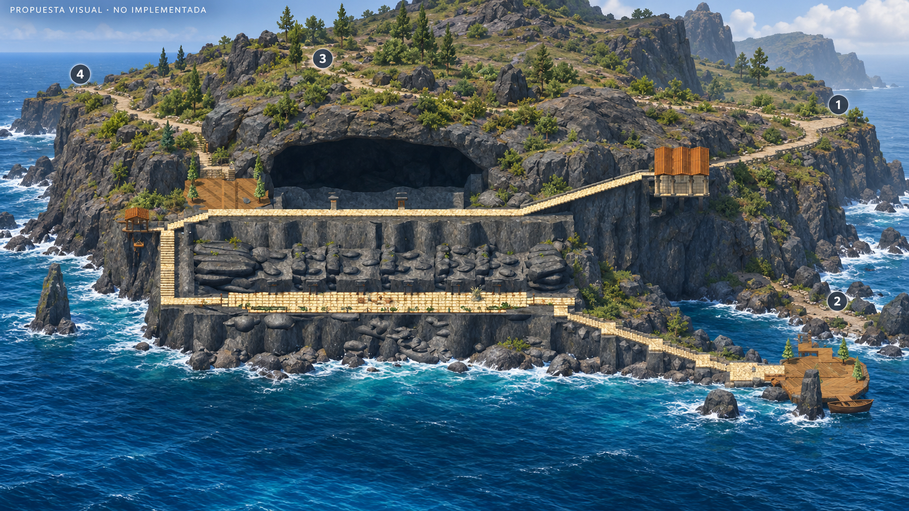
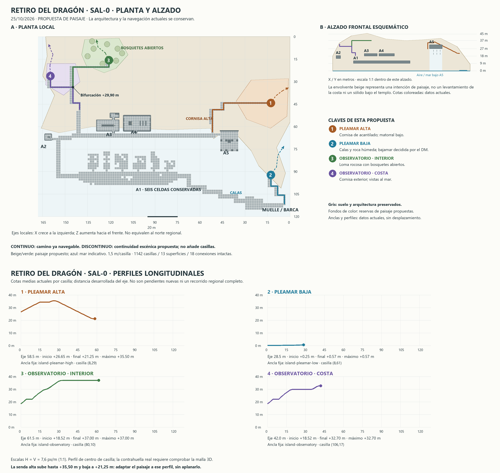

# Referencias visuales aprobadas del Retiro ·25/10/2026

El usuario confirma: «Perfecto estas imagenes van a roadmap, y imagenes de referencia. Ahora con esto, empieza la siguiente fase». SAL-0 queda aceptada conceptualmente y se autoriza iniciar SAL-1. Las fases posteriores no se inician automáticamente.

## Referencia de paisaje

Roca volcánica continua detrás y alrededor del Retiro; Pleamar alta por cornisa, Pleamar baja por calas, Observatorio por interior con bosquetes y alternativa costera. Se conserva el embarcadero a la derecha. Esta imagen orienta formas, carácter y composición; no autoriza mover o sustituir la arquitectura ni copiar un detalle generado como contenido canónico nuevo.

## Referencia técnica

[T05 planta/alzado ampliable](../references/retreat-departures-20261025/T05-planta-alzado.png) · [T06 perfiles ampliables](../references/retreat-departures-20261025/T06-perfiles.png).

Las líneas continuas y perfiles contienen datos actuales; fondos y discontinuas son paisaje previsto. Las coordenadas y alturas proceden de navegación vigente, no de una medición de la ilustración. Identificar rutas por sus IDs estables; los números gráficos1alta/2baja no cambian la numeración histórica ni los puertos.

Imágenes conservadas sin editar. Hashes de aprobación en [reference-approval.json](../../output/retreat-sal1-20261025/checks/reference-approval.json). El [roadmap maestro](../audits/RETREAT_TECHNICAL_ROADMAP_20261023.md) y la [ficha SAL](RETREAT_DEPARTURE_LANDSCAPE_PLAN_20261025.md) fijan alcance y aceptación. Preservar modelos, celdas/mobiliario y anclas existentes.

Archivo estable en `docs/references/retreat-departures-20261025/`, cotejado byte a byte con las cuatro imágenes aprobadas. Los originales de la entrega SAL-0 permanecen en `output/`; no se regeneraron ni se alteraron sus pruebas históricas.
