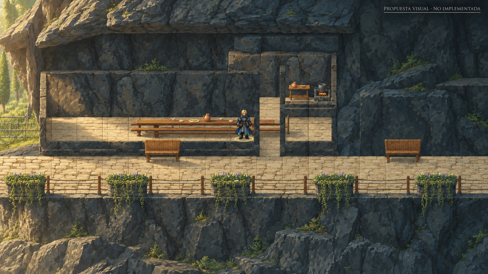
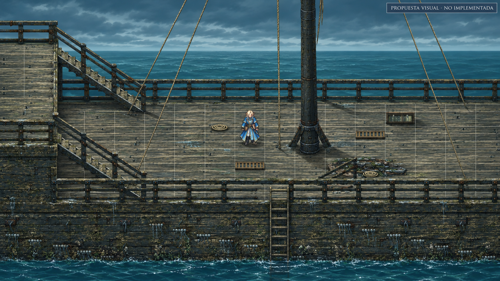

# Dirección artística común del VTT

Revisión: 01/11/2026. Aplicable a trabajo visual de D8 Night y Stormwreck Isle. Esta guía concreta el acabado de los mapas existentes; no autoriza implementar todos los cambios, sustituir escenarios o reordenar entregas de otros chats.

## 1. Objetivo común

Un battlemap de D&D vivo: escenario 2.5D legible, personajes identificables, materiales estilizados coherentes, iluminación con fuentes reconocibles y profundidad alrededor del grupo. Dados, conversación y decisiones permanecen en mesa. La cámara, cuadrícula y funciones actuales se conservan.

Las referencias principales son Octopath para profundidad/luz, Witchbrook para vegetación/mobiliario/color, Sea of Stars para coherencia de terreno/costa y Final Fantasy Tactics moderno para lectura táctica. Las demás son comparaciones secundarias, con el grado de revisión declarado en la [biblioteca](VISUAL_REFERENCE_LIBRARY.md). Referencia no equivale a arte aprobado ni a permiso de copiar assets.

## 2. Una familia visual, varias identidades de lugar

Unificar proporción de detalle, contraste, dibujo de bordes y respuesta de materiales. La piedra no debe parecer fotográfica mientras muebles y follaje parecen bloques simples y el personaje una ilustración de otra escala. Una textura de mayor resolución no es automáticamente mejor. El acabado se evalúa en cámara de juego, no en una ampliación de editor.

Stormwreck conserva su carácter costero/volcánico y la vegetación elegida por el usuario; no se vuelve un jardín mágico saturado por usar Witchbrook. Sylvania/D8 conserva piedra, revoco, roble, teja y carácter de cada escena; Espejo conserva frío/hielo y Cena su intimidad. Paletas existentes y referencias locales aprobadas son el punto de partida. Ajustar familias de luces y sombras sin aplicar el mismo tinte a todos los biomas.

La densidad de píxel/texel aparente se calibra con una muestra real a 15° y zoom medio, cuando ese ángulo esté admitido, más las cámaras actuales del mapa. Definir en la ficha el tamaño de textura, escala UV y tratamiento de bordes elegido. No imponer a toda la aplicación un filtro nearest-neighbor o un pixelado que destroce lectura, animación o paredes oblicuas.

## 3. Contrato de conservación

**Informes visuales desde el 02/11/2026:** los pares de capturas reales se comparan superpuestos: clic/toque en el antes muestra el después sobre el mismo encuadre y otro clic regresa. Conservar zoom/desplazamiento al alternar; permitir ampliación y teclado, con etiqueta clara del estado. Componente compartido `scripts/lib/visual-comparison.mjs`. Las láminas conceptuales no son un después ejecutado ni se presentan como una superposición exacta sobre el juego.

- Mejorar el mismo mapa: mantener distribución, huellas y funciones autorizadas, alturas de apoyo, escala de 1,5 m, navegación, puertas, puertos, colisiones y anclas. No modificar física por acomodar una ilustración.
- Conservar identidades, sprites/atlas recientes, animaciones, inventario, progreso y autoridad del servidor. Adaptar integración antes de reemplazar personajes.
- Detalles decorativos no crean obstáculos, peligros, botín, PNJ, habitaciones ni fuentes de luz narrativas nuevas. Distinguir `VTT_AMBIENCE` y `CANON`.
- Mantener preferencias de cámara, grid, controles y orientación estable de WASD/joystick. Revisar el perfil actual en código; no restaurar cifras de documentos históricos.
- Respetar cambios anteriores autorizados. «Conservar» significa conservar la base vigente de la escena; no volver al mapa original si el usuario ya aprobó una ampliación.
- Preservar trabajos de otros chats y referencias aprobadas. Una comparación con otro juego no invalida sus modelos, paletas o geografías automáticamente.

## 4. Superficies y objetos

| Familia | Criterio de mejora | Evitar |
| --- | --- | --- |
| Piedra | Masas grandes, juntas/estratos medios y desgaste pequeño; escala común entre muro, roca y pavimento | Ruido fotográfico repetido o relieve enorme en superficies pequeñas |
| Madera | Tablas, apoyos, espesor, borde y desgaste según uso; veta contenida | Cajas marrones lisas o una veta de tamaño incompatible |
| Tela | Pliegue legible, grosor, dobladillo/motivo si se aprecia jugando | Rectángulo plano o arrugas que parecen roca |
| Metal/cerámica | Reflejo pequeño, silueta y material distinto del soporte | Blanco quemado, cubiertos negros invisibles o brillo de plástico |
| Césped | Fondo tranquilo, grupos de briznas y pequeñas plantas; bordes con tierra/musgo según lugar | Misma brizna densa en toda la superficie, ruido o alfombra rectangular |
| Árboles | Tronco, ramas, huecos y racimos de hojas con silueta; especies y volumen general existentes | Bolas lisas o innumerables hojas planas sin masa legible |
| Agua/costa | Color y transparencia por profundidad, contacto con roca/orilla, espuma localizada y movimiento coherente | Lámina uniforme, bordes recortados que ocultan suelo o espuma por todas partes |
| Muebles | Construcción legible: patas, respaldo, asiento, grosor y pequeños conjuntos de objetos | Añadir objetos al azar o tapar caras, puertas y selección |

Cada conjunto debe mostrar un uso coherente: mesa con vajilla agrupada, estante con libros/recipientes, vegetación naciendo junto a juntas o tierra. Los encuentros suelo–muro, pata–suelo, hierba–camino y costa–roca son parte del recurso, no un retoque que se omite al final.

## 5. Luz y profundidad, entregables principales

Organizar primer plano parcial, llegada, plano del grupo, respaldo de casa/roca y distancia. Mejorar la presentación de las capas existentes antes de añadir otras. Comprobar siluetas, solapamiento, escala de detalle y contraste; el lugar debe seguir profundo sin desenfoque ni bruma.

La luz principal y relleno del cielo modelan volumen. Velas, ventanas, faroles y fuego contribuyen según sus fuentes reales. Materiales, muebles y personajes deben compartir ambiente, con sombras proyectadas y de contacto coherentes. Revisar los mecanismos existentes de luz local, sombras y recorte antes de duplicarlos.

Reloj, clima y órdenes DM mandan. Hay que comprobar día, crepúsculo, noche y estados propios del mapa, incluyendo fuentes apagadas. No imponer una hora perpetua, luz atravesando muros o brillo que permanece al apagar su fuente. Iluminación visual no cambia por sí sola visión autorizada o reglas de oscuridad.

La atmósfera separa planos: humo/partículas en posiciones justificadas, oclusión correcta y viento/movimiento reducido respetados. Haces, bloom, AO y profundidad de campo son recursos condicionados: se omiten si no aportan o no caben. El tablero, caras, pies, selección y acciones permanecen nítidos.

## 6. Método común de producción

1. Leer estado/código actual y ficha local. Registrar qué existe y qué sigue fallando; una foto histórica no invalida una mejora reciente.
2. Elegir una referencia principal por aspecto, indicando captura o fuente. Escribir qué se toma y qué queda fuera.
3. Acabar una muestra pequeña de la misma escena: suelo/piedra, madera/mueble, vegetación, personaje y luz juntos. Mantener colocación y física.
4. Comparar base/muestra con iguales cámara, posición, reloj, clima y estado. Corregir incoherencias antes de multiplicarlas por todo el mapa.
5. Extender la familia validada solo al alcance del bloque autorizado. Cada entrega deja una candidata jugable.
6. Registrar estados separados: construido, probado técnicamente, revisado visualmente, aceptado por usuario y probado físicamente. No deducir los últimos por pasar tests.

El flujo de recursos debe conservar original, derivado, procedencia, licencia, dimensiones, escala, pivote, variantes y uso en escena. Reutilizar bibliotecas locales/abiertas compatibles; no instalar o generar contenido por costumbre. Una referencia comercial no se convierte en CC0 por ser para una mesa privada. Las capturas de estudio no entran en `public/art`.

## 7. Evidencia mínima y límites

Antes/después equivalente desde llegada, foco principal, interior/borde y un lateral; giros permitidos y móvil vertical/horizontal cuando correspondan. Añadir una secuencia breve caminando/girando para observar oclusión, animación, pies y planos. Comprobar grid visible/oculto y las vistas integradas DM/jugador/proyector; Playground por sí solo no acredita acabado del juego.

Realizar verificaciones funcionales pertinentes. Anotar coste o regresión evidente del bloque y respetar el calendario de optimización local: el Retiro mantiene Q1 para el cierre previsto, sin reabrir largas baterías en cada retoque. No inventar FPS por contadores de mallas ni afirmar pruebas físicas no realizadas. Reducir efectos secundarios antes que composición, materiales o identificación en calidad baja.

## 8. Orden y coordinación

El [roadmap visual común](../VISUAL_ROADMAP.md) establece dependencias de acabado, no reemplaza el orden autorizado de cada campaña. El roadmap vigente del Retiro y sus referencias del 25/10 permanecen; Cena mantiene C01–C60/E0–E6; Pecio mantiene M5/M7 y requisitos canónicos. No renumerar esos trabajos ni declarar sus gates aprobados con esta guía.

El reparto Astra/Sol/Terra/Luna de `docs/HD2D_DIRECTION.md` y los relevos locales se conserva. Esta ampliación no cambia automáticamente modelos, no autoriza subagentes ni envía instrucciones a otros chats. El usuario decide cuándo cambiar de modelo y cualquier nueva instrucción explícita prevalece.

## 9. Propuesta visual concreta del Retiro y Pecio — 01/11/2026

**Dirección V1 aprobada el 01/11/2026:** el usuario elige «Acabado de las dos láminas (recomendado)». Se autoriza reproducir esta dirección en las muestras reales VIS-2 de Retiro y Pecio. La aceptación del acabado implementado y sus pruebas queda separada. Las láminas siguen siendo conceptos; su aprobación no convierte sus detalles generados en geometría o contenido obligatorio. [Ficha de valores/materiales y prompts](STORMWRECK_VISUAL_PROFILE.json), [láminas/paletas y comparación con el estado real](../../output/stormwreck-style-decisions-20261101/index.html). No es otro roadmap.

La recomendación es una familia **2.5D estilizada con texturas dibujadas y detalle agrupado**: la profundidad/luz de Octopath/II, el color y plantas/objetos de Witchbrook/Sea of Stars y lectura táctica de FFTactics Enhanced. Personajes existentes, mundo con materiales coherentes, superficies tranquilas y desgaste localizado. Sin filtro global de pixelado, fotografía ruidosa, brillo plástico ni desenfoque del tablero.

| Decisión de acabado propuesta | Retiro del Dragón | Pecio Rosa de los Vientos |
| --- | --- | --- |
| Carácter | Volcánico costero, vivido y sereno; suelo/madera templados con sombras frías | Salino, húmedo y envejecido; frío marítimo con luz cálida solo en fuentes reales |
| Piedra / estructura | Basalto `#515D60` / plano claro `#77817B`; caliza `#B9B09B` / sombra `#8D8975` | Madera estructural oscura `#343F3E` e hierro `#3A4647`; conservar rocas del lugar |
| Madera | Roble `#947451`, estructura `#66513D`, veta discreta | Tabla seca `#777B65`, mojada `#444F49`, sal en bordes/roturas existentes |
| Planta / otros materiales | Verdes `#526C48` / `#7D8C59`, racimos y huecos; especies y anclas actuales | Cabo `#A79D79`, tela `#A39B7F`, óxido puntual `#8E6950`; algas/humedad solo donde correspondan |
| Luz / agua | Sol y cielo vivos; relleno interior actual y sombras de contacto | Mar `#285A66` / `#427C84`; día/tormenta/noche según reloj/clima, sin hora perpetua |
| Construcción de objetos | Espesor, patas, cantos/uniones legibles sobre las piezas existentes | Tablas/herrajes/cabos y deterioro legibles, sin reparar ni añadir botín |

Los HEX son **anclas propuestas de la familia de color base**, no colores medidos de la imagen ni tintes impuestos a todas las superficies. La iluminación modifica el resultado. La ficha JSON fija candidatos iniciales de rugosidad/normal/UV y resolución; sus valores se calibran en el motor. En PBR leer canal ORM y multiplicador conjuntamente; en StandardMaterial una intención de roughness no se copia como propiedad inexistente. No se migra globalmente el Pecio a PBR.

Propuesta de detalle: piedra/suelo 1024² con repetición inicial de 6–8 m, madera 512² con 3–4 m, normal/ORM compartidos hasta 512² y atlas de props hasta 1024². Son presupuestos iniciales de muestra, no una orden de reescalar todos los archivos. Reutilizar recursos de calidad equivalente y las UV nativas válidas; no reproyectar las rocas curvadas. Comparar a 15° y zoom medio, además de cámaras actuales, con mipmaps/trilineal y sin nearest global.

Propuesta de grid por defecto: 18 % de opacidad, gris salvia `#A6ADA1`, línea de 1 px, conservando todas las preferencias guardadas y el modo adaptativo. Este documento no modifica la configuración real.

**Límites literales de las láminas:** orientan color, textura, construcción y ambiente. El generador sugiere detalles que no son instrucciones geométricas: los paneles de puerta del Retiro no se convierten en bancos por su dibujo; remaches/refuerzos/vegetación/cielo del concepto no autorizan objetos, reparaciones o nuevas zonas. Mandan los IDs, plantas y estados reales. No se sustituye un mapa por estas imágenes ni se incorporan como textura panorámica jugable.

El 02/11 se construyen las primeras muestras reales de materiales A3/umbral y cubierta/C4, más la familia de piedra continua compartida del Retiro y la finalización autorizada del cráneo. [Resultado, valores e IDs](../evidence/STORMWRECK_STYLE_SKULL_20261102.md), [capturas reales](../../output/stormwreck-style-sample-20261101/index.html), acceso `REVISAR-ACABADO.cmd`. Conservan geometría/UV/funciones, salvo la mejora del cráneo dentro de su huella. Muebles y vegetación no han sido remodelados. Las resoluciones reales y parámetros usados están registrados; la aceptación de la muestra y su extensión sigue pendiente. Aprobar un concepto no equivale a aprobar ejecución, rendimiento, dispositivos o parecido completo.
